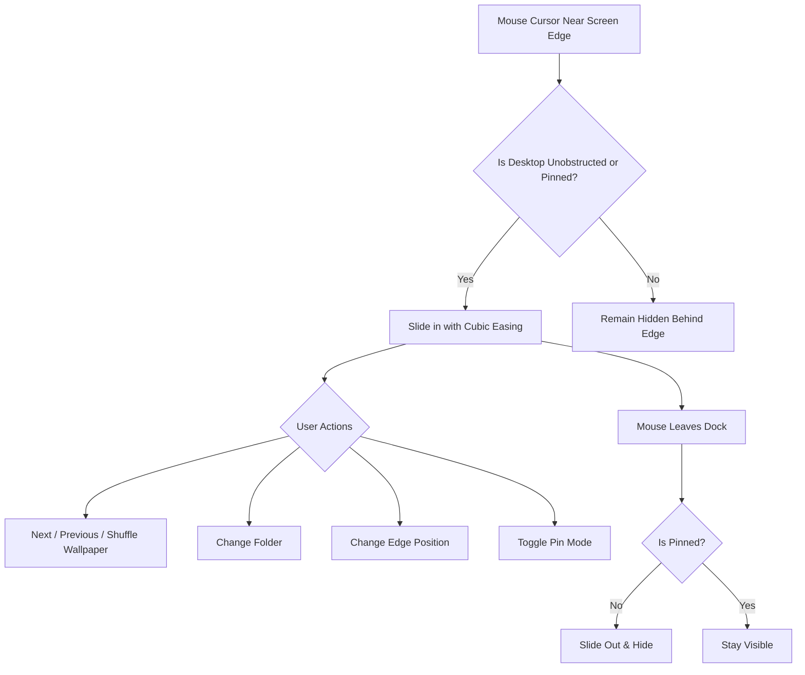

# WallChange 🖼️

[](https://microsoft.com)
[](https://dotnet.microsoft.com)
[](Tests/WallChange.Tests)
[](https://learn.microsoft.com/en-us/windows/apps/design/)

**WallChange** is a modern, lightweight, and unobtrusive Windows 11 desktop wallpaper changer. Designed to stay completely out of your way while you work, it docks discreetly along any screen edge and slides in smoothly only when your cursor approaches the edge of an unobstructed desktop surface.

---

## ✨ Features

- **🎯 Smart Desktop-Only Activation**  
  Unlike standard overlays that interrupt your workflow, WallChange continuously evaluates window focus and surface occlusion using low-level Win32 hooks (`SetWinEventHook`, `GetForegroundWindow`, `WindowFromPoint`). The dock **only slides in when the desktop is visible and unobstructed**.
- **🖥️ Multi-Monitor & Virtual Desktop Aware**  
  Detects cursor coordinates across multi-monitor setups dynamically (`MonitorFromPoint`), respects per-display DPI scaling, and filters out cloaked windows (`DWMWA_CLOAKED`) across Windows 11 Virtual Desktops.
- **🎨 Windows 11 Fluent & Mica Aesthetic with Theme Customization**  
  Crafted with clean frosted backdrops, subtle border gradients, rounded corners, soft drop shadows, and modern vector iconography. Features a dedicated Settings flyout with three distinct themes:
  - **Light Mode:** Crisp frosted grey-white mica aesthetic.
  - **Dark Mode:** Deep slate & charcoal mica styling.
  - **Adaptive Mode:** Dynamically extracts dominant hues, luminance, and contrast-safe accent colors directly from the active wallpaper.
- **📌 Edge Snapping & Pinning**  
  Snap the dock to any of the 4 screen edges on the fly. Need quick, persistent access while testing wallpapers? Toggle the pushpin to keep the dock pinned open.
- **🖼️ Comprehensive Wallpaper Control**  
  - Cycle sequentially (**Next** / **Previous**) or shuffle (**Random**).
  - Open any custom wallpaper folder or fall back to Windows system wallpapers.
  - Broad format support: `.jpg`, `.jpeg`, `.png`, `.bmp`, `.webp`, `.jfif`, `.tiff`, `.tif`.
  - Native wallpaper scaling options: *Fill*, *Fit*, *Stretch*, *Tile*, *Center*, and *Span*.
- **💾 Automatic Persistence**  
  Retains your chosen folder, theme preference, last wallpaper index, dock edge placement, and pin state in `%LocalAppData%\WallChange\settings.json`.
- **🧪 Robust Test Suite**  
  Backed by 32 automated xUnit tests covering settings persistence, theme adaptation, edge snapping geometry, desktop detection heuristics, and folder scanning.

---

## 🏗️ Architecture & Project Structure

WallChange is organized into modular layers:

```
WallChange/
├── Core/                        # Core application engine & Win32 integrations
│   ├── AppSettings.cs           # Configuration data model
│   ├── DesktopDetector.cs       # Win32 foreground & desktop surface hit-testing
│   ├── SettingsManager.cs       # JSON persistence (%LocalAppData%\WallChange)
│   ├── WallpaperManager.cs      # Image scanning, indexing, shuffle, and event model
│   ├── WallpaperNative.cs       # Win32 SystemParametersInfo & Registry integration
│   └── WallpaperStyle.cs        # Enum for desktop wallpaper fit/fill modes
├── UI/                          # Presentation layer (WPF + Win32 interop)
│   ├── MainOverlayWindow.xaml   # Fluent-styled overlay panel layout
│   ├── MainOverlayWindow.xaml.cs# Animation controllers, hover & edge docking logic
│   ├── NativeWindowHelper.cs    # ToolWindow styles & DWM layer configuration
│   └── ScreenEdge.cs            # Edge anchor definitions & position calculation
├── Tests/
│   └── WallChange.Tests/        # Automated xUnit test suite (26 tests)
│       ├── DesktopDetectorTests.cs
│       ├── ScreenEdgeTests.cs
│       ├── SettingsManagerTests.cs
│       └── WallpaperManagerTests.cs
└── WallChange.csproj            # Main application project file (.NET 10.0-windows)
```

---

## 🚀 Getting Started

### Prerequisites

- **OS:** Windows 10 (Build 19041+) or Windows 11 (Recommended)
- **SDK:** [.NET 10.0 SDK](https://dotnet.microsoft.com/download)

### Installation & Build

1. **Clone the repository:**
   ```bash
   git clone https://github.com/vector4653/WallChange.git
   cd WallChange
   ```

2. **Restore dependencies & build:**
   ```bash
   dotnet build
   ```

3. **Run the application:**
   ```bash
   dotnet run
   ```

### Running Unit Tests

Run the full xUnit test suite with:

```bash
dotnet test
```

---

## 🎮 How It Works



1. **Dock Position:** Select your preferred dock position (Top, Bottom, Left, or Right) via the dropdown.
2. **Hover Trigger:** Move your cursor to the corresponding screen edge over your desktop. The dock smoothly glides into view.
3. **Change Wallpaper:** Use the arrow buttons or the random button to update your wallpaper instantly.
4. **Custom Folder:** Click **Folder** to choose any directory containing images on your system.
5. **Autohide:** Move the cursor away from the panel, and it slides discreetly out of view.

---

## ⚙️ Configuration Storage

Settings are automatically saved on every change to:

```
%LocalAppData%\WallChange\settings.json
```

**Sample configuration:**

```json
{
  "WallpaperDirectory": "C:\\Users\\Username\\Pictures\\Wallpapers",
  "LastWallpaperIndex": 12,
  "LastWallpaperPath": "C:\\Users\\Username\\Pictures\\Wallpapers\\mountains.jpg",
  "DockEdge": "TopMiddle",
  "IsPinned": false,
  "WallpaperStyle": 0
}
```

---

## 🗺️ Roadmap

- [x] **Phase 1:** Core Logic & Directory Scanner
- [x] **Phase 2:** UI Foundation, Fluent Design & Edge Snapping
- [x] **Phase 3:** Desktop Surface & Foreground Detection
- [ ] **Phase 4:** Wallpaper Transition Animation Engine (Crossfade / Slide via desktop worker window)
- [ ] **Phase 5:** Interval Switch Timer & Automation Service

---

## 📄 License

This project is licensed under the [MIT License](LICENSE) (or your preferred license).
